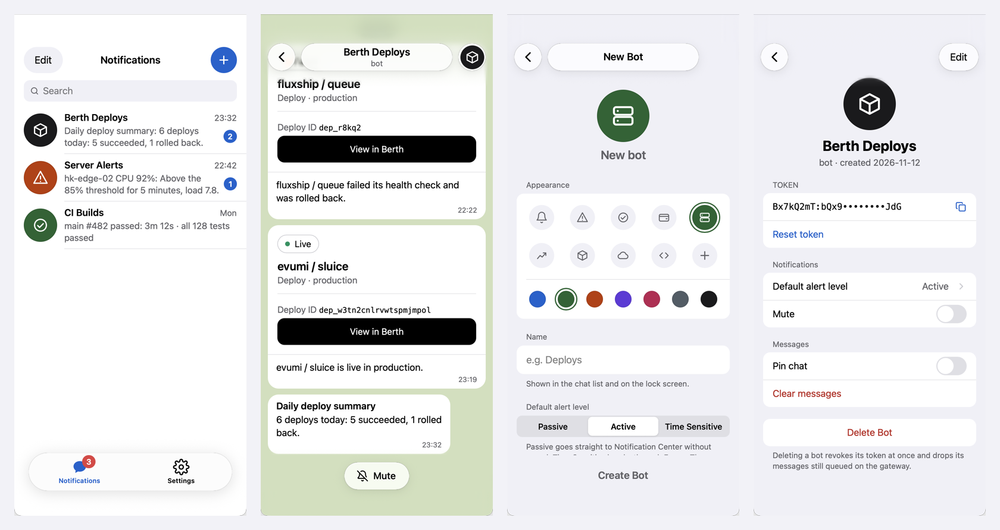

# Honk

[中文](README.zh-CN.md)



Honk is a push notification service built around bots: each bot is its own channel, and a message can carry a small HTML card in the format of Telegram's HTML widgets (Bot API 10.4). iOS receives pushes through APNs; Android through FCM (GMS devices only).

## Layout

| Directory | Contents | Status |
| --- | --- | --- |
| `gateway/` | Go + SQLite gateway: bot API, app API, short-term queue, APNs/FCM push | first version |
| `app/` | nsh app (TSX): chat list, message stream, card rendering | first version |
| `ios/` | Swift host, Notification Service Extension, shared HonkKit package | first version; built for the simulator in CI (`iosapp` job), not yet verified on a real device |
| `android/` | Kotlin host embedding the nsh app, FirebaseMessagingService, shared `:core` module (gateway client, local store, sync) | first version; `:core` tested on the JVM, the app built in CI (`android` job), not yet verified on a real device |
| `sdk/` | Bot API SDKs for Go (`sdk/go`) and TypeScript (`sdk/js`, `@evumi/honk`) | first version; tested against a running gateway in CI |

The development design (Chinese) is [docs/DESIGN.zh-CN.md](docs/DESIGN.zh-CN.md); mockups and screenshots are in [docs/design](docs/design/).

## How it works

1. The app registers its APNs/FCM push token and gets a `device_secret`.
2. The app creates a bot and gets its token, `<bot id>:<secret>`, for example `aZ3kQ9xT:Gw2K7mx…`. A bot id is 8 random base62 characters starting with a letter, never a sequence number.
3. A sender calls `/bot<token>/sendMessage`. The gateway queues the message and sends a push with the banner text and the `msg_id` only.
4. On the device, the Notification Service Extension (iOS) or FCM service (Android) fetches `GET /v1/messages/:id`, card included, and stores it locally.
5. When the app opens it calls `GET /v1/sync` for anything missed, then `POST /v1/ack`.

Queued messages expire after 7 days; a message that every device of the group has acked is deleted a day after it was created (`HONK_ACKED_KEEP`).

A push that fails for a reason that may pass (a network error, a timeout, a 5xx, a 429 with its `retry_after`) is retried from a bounded in-memory queue after 2 s, 10 s and 60 s, four attempts in all; it is dropped when that device has acked the message or its push token changed meanwhile. Retries are not kept across a restart: the device still gets the message from `/v1/sync`. The apps also sync in the background about every six hours (iOS `BGAppRefreshTask`, Android WorkManager), which applies edits and deletes and updates the badge but never posts notifications.

## Several phones: device groups

A phone is not tied to its bots: devices that were paired form a **device group**, which shares the bots and the queue. Every message is pushed to every device of the group that can take a push (edits and deletes too), and each device keeps its own sync cursor and ack watermark, so a slow phone never loses a message to a fast one. A message leaves the queue when it has expired, or when every device of the group has acked it and it is older than `HONK_ACKED_KEEP`. Muting, pinning and read state stay on each phone; older local history does not move (only what is still queued does).

To switch phones or add one, open Settings → Devices → Add device on the old phone: it shows a 26-character pairing code (16 random bytes in Crockford base32, grouped in fours; nsh has no QR code API, so it is text only, with a copy button). On the new phone use "Already have a device? Enter a pairing code" (Settings, or the empty home screen). The code is good for 10 minutes and works once; the gateway never sees it, only a `link_id` and the bot tokens encrypted with a key, both derived from the code with HKDF-SHA256. The new phone's own bots, if it had any, join the group too. Claims are limited per client IP, so a code cannot be guessed. There is no recovery for a lost phone with no other device: bot tokens only exist on devices and in the groups' senders, so create the bots again.

Settings → Devices lists the group (name, platform, last seen, this device); a device can be removed from there. Data has two buttons: "Remove this device from the group" (this phone leaves, the bots stay with the others) and "Delete all data" (the whole group's devices, bots and queue on the gateway, then this phone). A device whose push token has been rejected and that has made no request for `HONK_DEVICE_GC` (90 days) is deleted by the gateway, together with the bots and queue when it was the last device of its group.

## Messages on the phone

Everything below happens on the device; the gateway is not involved.

- **Search**: the search box on the chat list also finds messages (title and body) and lists them under the matching chats; tapping one opens the chat at that message.
- **Retention**: Settings keeps messages forever (default), 1 year, 90 days or 30 days. Older ones are deleted from the phone at start and on every sync; the gateway is not affected.
- **Export and import**: Bot settings exports one chat, Settings all of them, as a JSON Lines file (one message per line, the fields of the App API's message objects with `bot_id`) through the system share sheet. Settings imports such a file again. Importing twice changes nothing; messages of bots this phone does not have are skipped.
- **iPad**: the iOS app runs on iPad, with its pages in a centred column at most 600 points wide.
- Android notifications show the same preset avatar icons as the app.

## Running the gateway

Hosting your own gateway: see [docs/SELF-HOSTING.md](docs/SELF-HOSTING.md) (Docker Compose, reverse proxy and TLS, backups, upgrades).

```bash
cd gateway
make run        # works without push credentials (relay off): pushes are skipped
make test
```

The gateway also serves its own landing page at `/` and API docs at `/docs` (Chinese and English, light and dark), with the gateway's address filled into every example. They are static files embedded in the binary (`gateway/internal/web/site`, hand-written HTML, CSS and JavaScript, no build step) and load nothing from other origins.

See `gateway/Dockerfile` for the container. Settings:

| Variable | Default | Meaning |
| --- | --- | --- |
| `HONK_ADDR` | `:8080` | listen address |
| `HONK_DB` | `./data/honk.db` | SQLite file |
| `HONK_MESSAGE_TTL` | `168h` | how long a message stays queued |
| `HONK_ACKED_KEEP` | `24h` | how long a message that every device of the group has acked is kept (counted from its creation) |
| `HONK_DEVICE_GC` | `2160h` | a device whose push token is gone and that made no request for this long is deleted, with the group's bots and queue if it was the last; `0` or `off` never deletes |
| `HONK_SEND_RATE` / `HONK_SEND_BURST` | `10` / `60` | per-bot messages per second / burst (an alert storm or a burst of CI events fits in the burst) |
| `HONK_TRUSTED_PROXIES` | loopback + private ranges | comma-separated CIDRs of reverse proxies whose `X-Forwarded-For` / `X-Real-IP` are believed for per-IP limits (the right-most address not in the list is the client; IPv6 clients are keyed by /64); `none` trusts no one, so only the TCP peer counts |
| `HONK_REGISTER_PER_HOUR` | `10` | device registrations per client IP per hour (burst 5) |
| `HONK_MAX_BOTS_PER_DEVICE` | `100` | bots one device group can own (the name is from before groups); a pairing that would exceed it is refused |
| `HONK_WEBHOOK_ALLOW_PRIVATE` | `false` | let bots set a `setWebhook` url on loopback, private and link-local addresses (off: refused, so a bot cannot make the gateway call your internal network) |
| `HONK_APNS_KEY_FILE` | | APNs `.p8` key; iOS push is off without it |
| `HONK_APNS_KEY_ID` / `HONK_APNS_TEAM_ID` / `HONK_APNS_TOPIC` | | required with the key; the topic is the bundle ID |
| `HONK_APNS_SANDBOX` | `false` | use the APNs development gateway (debug builds) |
| `HONK_FCM_CREDENTIALS_FILE` | | Firebase service account JSON; Android push is off without it |
| `HONK_PUSH_QUEUE` / `HONK_PUSH_WORKERS` | `1024` / `16` | pushes that may wait in the queue (a full queue drops and counts) / pushes in flight at once |
| `HONK_RELAY_URL` | `https://honk.bunship.site/` | the push relay a platform without direct credentials uses; `off` turns it off (that platform then gets no pushes). See [Push relay](#push-relay) |
| `HONK_RELAY_SERVE` | `false` | serve `/v1/relay/*` for other gateways; refuses to start unless at least one platform has direct credentials |
| `HONK_PUSH_CONTENT` | `full` direct, `none` through a relay | `full` puts the bot name, title and body in the push, `none` only ids (APNs shows "New notification" until the device fetches the message). Set it to choose for both routes |
| `HONK_RELAY_RATE` / `HONK_RELAY_BURST` | `10` / `100` | relay side: pushes per second / burst per relayed gateway |
| `HONK_RELAY_TOKEN_PER_MINUTE` | `60` | relay side: pushes per push token per minute |
| `HONK_REGISTER_KEY` | | when set, `POST /v1/devices` must carry the same `register_key`; `/v1/info` then reports `register_key_required`. The app's Gateway page has an optional register key field |
| `HONK_METRICS_ADDR` | | e.g. `127.0.0.1:9100`: serves Prometheus text at `/metrics` on its own listener; off when empty |
| `HONK_LOG_FORMAT` | `text` | `json` for structured logs |
| `HONK_LOG_LEVEL` | `info` | `debug` also logs every request (the bot token in the path is hidden) |
| `HONK_SITE` | `true` | serve the landing page at `/` and the API docs at `/docs` (`false`: both are 404) |

`/metrics` has `honk_messages_total{kind}`, `honk_pushes_total{platform,route,result}` (`route` `direct` or `relay`; `ok`, `retry`, `token_gone`, `failed`), `honk_relay_requests_total{result}` and `honk_relay_pushes_total{platform}` on a relay, `honk_push_retries_total`, `honk_push_dropped_total{reason}`, `honk_http_requests_total{class}`, and the gauges `honk_devices`, `honk_bots` and `honk_push_queue_length`.

## Push relay

APNs and FCM only accept pushes signed with the credentials of the published app, so a self-hosted gateway has none of its own. Without credentials for a platform, the gateway sends each push as one HTTP request to a relay (by default the official gateway at `https://honk.bunship.site/`), which passes it to APNs or FCM and answers with the result. The app still talks only to your gateway, and registration is unchanged. The start-up log says which route each platform uses.

1. A sender calls `sendMessage` on your gateway, which keeps the queue and the content.
2. Your gateway sends the push token, `msg_id`, bot id, level and a hashed collapse key to the relay.
3. The relay sends the push to APNs/FCM and wakes the device.
4. The device fetches `GET /v1/messages/:id` from your gateway and builds the banner from it.

By default a relayed push carries **no content** (`HONK_PUSH_CONTENT=none`): no bot name, title or body, and the sender's `id` only as a hash. iOS shows the localised "New notification" until the extension has fetched the message, then the real text; Android does the same from the fetched message. With `HONK_PUSH_CONTENT=full` the bot name, title and body (cut to the usual banner length) go through the relay and Apple/Google as they do on a direct push. The relay does not store pushes; it keeps a table of registered gateways (id, a hash of the key, timestamps, `blocked`) and in-memory counters.

Protocol (Telegram's `{"ok":…}` envelope):

- `POST /v1/relay/gateways` registers a gateway without any account and returns `relay_id` and `relay_key` once; the gateway keeps them in its `meta` table. Limited per client IP like device registration.
- `POST /v1/relay/push` with `Authorization: Bearer <relay_key>` and JSON `platform`, `token`, `kind`, `msg_id`, `target_id`, `bot_id`, `level`, `collapse_key`, `silent` (a silent message) and `ttl` (seconds the push may wait for an offline device) when set (and `bot_name`, `title`, `body`, `group` for `full`). Body at most 8 KB.
- Answers: 200 sent; 410 the token is gone (the gateway marks it, as for a direct push); 429 with `parameters.retry_after` (retried by the push queue); 401 unknown or blocked key (not retried; an unknown key makes the gateway register again, at most once an hour, a blocked one does not); 503 the relay has no credentials for the platform (not retried); 5xx and network errors are retried.

Serving a relay: set `HONK_RELAY_SERVE=true` next to your own credentials. It sends through its direct credentials only and never forwards to another relay. Each relayed gateway and each push token is rate limited; a gateway that sends over 100 dead tokens in an hour, more than half of its pushes, is slowed down and logged, and a relay can be blocked with `UPDATE relays SET blocked = 1 WHERE id = '…'`. `/v1/info` reports `features: ["relay"]`, and every gateway reports `push: {"ios","android"}` as `direct`, `relay` or `off`; the app's Gateway page shows it when you test a gateway.

## Bot API

`/bot<token>/<method>`, parameters in the query string, a form or JSON. Responses use Telegram's envelope: `{"ok":true,"result":…}` or `{"ok":false,"error_code":400,"description":"…"}`.

- `sendMessage`: `body` (required, 4096 characters; the banner text and the fallback for clients without cards), `title`, `html` (card: 32 KB raw, 4 KB after zlib), `data` (1 KB, fills `{{key}}` placeholders), `level` (`passive` \| `active` \| `timeSensitive`), `group`, `id` (a later message with the same id replaces this one), `url`, `copy`, `icon` (https), `open`, `image`, `ttl`, `silent`, `parse_mode`:

  | Parameter | Behaviour |
  | --- | --- |
  | `open` | `chat` (default) or `url`: with `url`, tapping the notification opens the message's `url` instead of the chat (needs `url`) |
  | `image` | https URL, up to 2048 characters: attached to the notification and shown above the text in the chat. The device downloads it (5 MB, 10 s) |
  | `ttl` | seconds, 60 up to `HONK_MESSAGE_TTL`: how long the message stays in the queue; also the APNs `apns-expiration` and the FCM `ttl` |
  | `silent` | `true`: no banner and no notification; the message goes to the chat and the unread count and badge, through a silent push |
  | `parse_mode` | `Markdown`: the body is rendered as Markdown (`**bold**`, `*italic*`, `` `code` ``, fenced code blocks, `[text](https://…)` links, `-` and `1.` lists); the banner shows the text without the marks |

  Without `parse_mode`, `https://` links in the body can be tapped. Notifications have a "Copy" button when the message has `copy`, an "Open link" button when it has `url`, and always "Mark as read".
- `sendMessage` also takes `dry_run` (`true`): validate only. Nothing is queued or pushed; the result is `{"dry_run":true,"html":<cleaned card>,"input_size","raw_size","compressed_size","removed":[…]}` with the sizes of the cleaned card (limits 32768 and 4096) and what the whitelist removed (`"onclick on <div>"`, `"<iframe>"`). It counts against the rate limit.
- `sendMessage` also takes `ciphertext` instead of the content parameters, for a bot with [end-to-end encryption](#end-to-end-encryption) (required once the bot has it turned on); `level`, `group`, `id`, `ttl`, `silent`, `open`, `parse_mode` and `allow_queries` stay plain.
- `editMessageData`: `message_id` or `id`, and `data` (or `ciphertext` sealing `{"data":"…"}`). Updates the card silently.
- `deleteMessage`: `message_id` or `id`. Removes the message and its notification.
- `getMe`: the bot.
- Widget queries, as in Telegram's Bot API (field names follow `WidgetQuery` and `answerWidgetQuery`). A card sent with `allow_queries` can call `request(data)` (1–64 bytes); the app posts it to the gateway, which hands it to the bot as the update `{"update_id":N,"widget_query":{"id","message_id","data"}}` and holds the app's request for up to 15 s. The bot picks the update up in one of two ways, not both:
  - `setWebhook`: `url` (https only; an empty `url` removes it) and optional `secret_token` (sent back in the `X-Honk-Bot-Api-Secret-Token` header). The gateway POSTs the update as JSON with a 5 s timeout and follows no redirects. It refuses hosts that resolve to loopback, private, link-local or other internal addresses (checked when the webhook is set and again on every connection) unless `HONK_WEBHOOK_ALLOW_PRIVATE=true`. `deleteWebhook` removes it; `getWebhookInfo` returns `url`, `has_custom_certificate` and `pending_update_count`.
  - `getUpdates`: `offset`, `limit` (1–100), `timeout` (0–50 s, long poll). Updates are kept in memory for 15 s; an update below `offset` is confirmed and dropped. It answers `409 Conflict` while a webhook is set.
- `answerWidgetQuery`: `widget_query_id` and `data` (0–1024 bytes), within 15 s. The answer goes only to the device that asked; a query that timed out, was answered already or belongs to another bot is `400`.

Gateways before short bot ids (database schema v1) gave bots integer ids, so their tokens look like `4:Gw2K7mx…`. Upgrading gives every bot a short id; the old tokens keep working until they are reset, and a reset token starts with the short id. The app moves each bot's local messages and settings to its new id the first time it syncs, using the stored token to ask `getMe` which bot it is, or matching its creation time and name when it has no token; if the gateway can't be reached, it keeps the bot and tries again later. Update the apps before the gateway: older app builds cannot read short ids (`/v1/info` reports `api` 2), while new builds also work with an old gateway.

Card HTML keeps whitelisted elements: text and structure, tables, `details`, `button`, `a`, `style`, `img` with `data:` images, inline SVG, and inline `<script>` (profile 2, below). It removes external and module scripts, `on*` handlers, form controls, external resources (links other than `https://`, `#id` or `{{key}}`) CSS that loads anything (`@import`, `expression()`, `url()` other than `data:` images), and SVG attribute values with a `url()` other than `url(#id)` or a CSS escape (`\`). The client applies its own CSS whitelist when rendering.

The app draws inline SVG (`svg`, `g`, shapes, `text`/`tspan`, gradients, `symbol`/`use`) as an image: it writes the sanitized subtree back out as SVG markup, keeping only whitelisted elements and attributes, `use` references within the card (`#id`) and `url(#id)` paint, and rasterizes it. Its size comes from CSS, else the `width` and `height` attributes (`width="100%"` fills the card's width; `height` in px), else the `viewBox` ratio; `preserveAspectRatio` (including `none`) sets how it fills that box. `{{key}}`, `var()` and `currentColor` are resolved before drawing; `<style>` rules do not reach inside the SVG, so give its elements attributes or fixed colours. A `<title>` or `aria-label` becomes its accessibility label. Older apps skip inline SVG.

Cards can be styled as Telegram widgets are, with `<style>` blocks as well as `style=""`: type, `.class`, `#id` and attribute selectors, compounds (`div.card`), descendant, child (`>`) and sibling (`+`, `~`) combinators, `:first-child` / `:last-child` / `:nth-child()`, `:root` (also `html` and `body`), and several selectors per rule, with the usual specificity and order; inline style wins unless a rule is `!important`. Custom properties (`--x` on `:root` or any element, read with `var()`), the theme's `--tg-theme-*` variables, `light-dark()` and `@media (prefers-color-scheme: dark)` follow the app's appearance; `display: none` hides an element. `{{key}}` works inside `<style>` and in `class`. The first 400 rules apply; other media queries, `@keyframes`, pseudo-elements and `:hover` are ignored.

Cards can carry inline scripts, as Telegram's HTML widgets do (card profile 2). The iOS and Android apps run each card's scripts in a QuickJS runtime of its own ([quickjs-ng](https://github.com/quickjs-ng/quickjs), `native/`) on a background thread, with no network or files, 8 MB of memory and 200 ms per task; past that the card stops and keeps what it last drew. `window.TelegramWidget` gives `chatData` (the message's `data`), `themeParams`, `colorScheme`, `onEvent('themeChanged' | 'activated' | 'deactivated', …)`, and `openLink(url)` / `copyText(text)` from a tap handler. Scripts change the card through a small DOM (`getElementById`, `querySelector`, `textContent`, `innerHTML`, `classList`, `style`, `dataset`, `createElement`, `addEventListener('click', …)`) and have timers and a 4 KB `localStorage`; the app draws what they produce through the same whitelist. `request(data)` (1–64 bytes, from a tap handler, once per tap) sends a query to the bot and returns a Promise for its answer (up to 1 KB) when the message was sent with `allow_queries`; the app sends it to the gateway itself and the bot answers with `answerWidgetQuery` (see Bot API). It rejects with a `WidgetRequestError` whose `code` is `NOT_ALLOWED` (the message does not allow queries), `INVALID_DATA`, `TOO_MANY_REQUESTS`, `TIMEOUT` (no answer in 15 s), `NETWORK`, `RATE_LIMITED` (more than 1 a second) or `REQUEST_FAILED`. Older apps, and the desktop demo, show the static card with `{{key}}` filled in. The gateway keeps inline scripts and removes external and module scripts. Example:

```html
<p id="n">{{count}}</p><button id="b">+1</button>
<script>
  let n = Number(JSON.parse(TelegramWidget.chatData).count);
  document.getElementById("b").addEventListener("click", () => {
    document.getElementById("n").textContent = String(++n);
  });
</script>
```

## Command line

The gateway binary is also a sender tool. `honk` with no arguments (or `honk serve`) runs the gateway exactly as before; the other subcommands talk to a gateway as one bot.

Every `v*` release has `honk` prebuilt for Linux, macOS and Windows (amd64 and arm64, `.github/workflows/gateway-release.yml`). On macOS and Linux:

```bash
curl -fsSL https://honk.example.com/install.sh | sh
```

Every gateway serves the script at `/install.sh` (it is `gateway/internal/web/site/install.sh`). It downloads `honk_<os>_<arch>.tar.gz` from the latest GitHub Release, checks it against `honk_checksums.txt` and installs to `/usr/local/bin`, or, when that is not writable, to `~/.local/bin` or `~/bin` if one is on `PATH` (otherwise it says which shell file to add it to); run it again to upgrade. By default it takes the newest release that has the command line in it. `HONK_VERSION=v1.2.3` picks a release, `HONK_INSTALL_DIR` the directory, `HONK_DOWNLOAD_URL` a mirror directory holding one release's files (instead of `HONK_VERSION`). On Windows, unzip `honk_windows_amd64.zip` from the releases page. Other ways: `docker run --rm -e HONK_URL -e HONK_TOKEN ghcr.io/evumi/honk-gateway send …` (the image's entrypoint is `honk`), `go install github.com/evumi/honk/gateway/cmd/honk@latest` (Go 1.26), or `make build` in `gateway/` (`bin/honk`). `honk version` prints the version.


```bash
export HONK_URL=https://honk.example.com HONK_TOKEN=aZ3kQ9xT:Gw2K7mx…
honk send "backup finished" --title Backup --level passive
make 2>&1 | tail -5 | honk send --title "Build log"        # stdin is the body when piped
honk send "api v1.8.2 is live" --html @card.html --data @data.json --id deploy-api
honk edit --id deploy-api --data '{"status":"rolled back"}'
honk delete --id deploy-api
honk me                                                     # the bot behind the token
honk preview card.html --data data.json --watch             # resend on every save
```

- `HONK_URL` and `HONK_TOKEN` can also come from `--server` / `--token`, or from `~/.config/honk/config.json` (`{"url": "…", "token": "…"}`; `$XDG_CONFIG_HOME` and `$HONK_CONFIG` are honoured). Flags beat the environment, which beats the file.
- `send` flags: `--title`, `--body` (or the arguments, or stdin), `--html`, `--data` (both accept `@file`), `--id`, `--level`, `--group`, `--link` (the `url` parameter), `--copy`, `--icon`, `--dry-run`.
- `preview` sends with a fixed `id` (default `honk-preview`) and `level=passive`, so the message on the phone is replaced in place and stays quiet. It runs a `dry_run` first and prints the sizes and what the whitelist removed. See the [card cookbook](docs/CARDS.md).
- Exit status is 0 on success, 1 when the gateway or the network fails (the gateway's `description` is printed to stderr) and 2 for a usage error.
- `--key <base64 key>` (or `HONK_KEY`, or `"key"` in the config file) encrypts the message content on the client: title, body, html, data, url, copy and icon go into one AES-256-GCM ciphertext, sent as `ciphertext`, while `level`, `group` and `id` stay plain. The key is the one the app shows in the bot's settings; see [End-to-end encryption](#end-to-end-encryption).

## SDKs

Libraries for the Bot API, so a program does not have to build requests, seal content or run the widget query loop itself. Both have no dependencies and cover every method: send (cards, `dry_run`), edit, delete, `getMe`, end-to-end encryption with the bot's key, and widget queries by long polling or as a webhook handler that checks the secret token.

| Language | Install | Docs |
| --- | --- | --- |
| Go 1.22+ | `go get github.com/evumi/honk/sdk/go` | [sdk/go](sdk/go/README.md) |
| TypeScript / JavaScript (Node 20+, Bun, Deno, Workers) | `npm install @evumi/honk` | [sdk/js](sdk/js/README.md) |

```ts
import { Honk } from "@evumi/honk";

const honk = new Honk({ url: process.env.HONK_URL!, token: process.env.HONK_TOKEN!, key: process.env.HONK_KEY });
await honk.send({ title: "Deploy", body: "api v1.8.2 is live", html: "<button>Roll back</button>", allowQueries: true });
await honk.poll(async (q) => (q.data === "rollback" ? await rollback() : "unknown"));
```

```go
c := &honk.Client{URL: os.Getenv("HONK_URL"), Token: os.Getenv("HONK_TOKEN")}
_, err := c.Send(ctx, honk.Message{Title: "Deploy", Body: "api v1.8.2 is live", Level: honk.Passive})
```

Both test against `app/src/e2e.vector.json` and, in CI, against a running gateway (`HONK_E2E_GATEWAY`). Go releases are tagged `sdk/go/vX.Y.Z`; npm releases `sdk/js/vX.Y.Z` (`.github/workflows/sdk-js-release.yml`).

## End-to-end encryption

Turn it on per bot: Bot settings, End-to-end encryption. The app generates a 32-byte key, keeps it in the keychain shared with the notification extension (iOS) or in Keystore-backed encrypted preferences (Android), shows it next to the token with a copy button, and tells the gateway the bot is encrypted (`PATCH /v1/bots/:id {"encrypted":true}`). From then on the gateway answers a plaintext `sendMessage` or `editMessageData` for that bot with a 400. A sender needs the token and the key. Resetting the key makes a new one and invalidates the old; messages already received stay readable. With several devices (a [device group](#how-it-works)), the group has a 32-byte group key made on the first pairing; each device keeps it in its keychain or keystore, and it never reaches the gateway in clear: the pairing bundle, sealed with the pairing code, carries it (with the bots' keys) to a new phone. When a bot's key is turned on or reset on any device, the app seals it with the group key and stores the result on the gateway as the bot's `key_wrapped` (`PATCH /v1/bots/:id`, returned by `GET /v1/bots`), and the group's other devices unwrap it on their next refresh or when a message does not open, so they can decrypt right away. A phone that joins a group with its own encrypted bots adopts the group key and re-wraps those keys with it. The gateway cannot open `key_wrapped`. Turning encryption off deletes the key on the device and lets the bot send plaintext again.

It keeps message content from the gateway operator, a leaked database, a push relay, Apple and Google. It does not protect against a compromised sender, a compromised device, or traffic analysis: the gateway still sees which bot gets a message, when, how big, and the plaintext `level`, `group`, `id`, `ttl`, `silent`, `open`, `parse_mode` and `allow_queries`. Pushes for encrypted messages carry no title, body or bot name (the banner is built on the device after decrypting); a message that cannot be decrypted (no key on this device, the wrong key) shows as "Couldn't decrypt this notification".

| | |
| --- | --- |
| Parameter | `ciphertext` on `sendMessage`, base64url, at most 64 KB. `body` is not required then, and `title`, `body`, `html`, `data`, `url`, `copy`, `icon` next to it are refused |
| Bytes | 12-byte nonce, then the AES-256-GCM ciphertext, then the 16-byte tag; unpadded base64url |
| Plaintext | JSON `{"title","body","html","data","url","copy","icon","image"}`; every field is a string and optional (`data` is the JSON text, as in a plain send) |
| AAD | the bot's short id, the part of the token before the `:` |
| Still plain | `level`, `group`, `id`, `ttl`, `silent`, `open`, `parse_mode`, `allow_queries` |
| Edit | `editMessageData` takes `ciphertext` whose plaintext is `{"data":"…"}` |

The gateway cannot check what it cannot read, so the app does it after decrypting: a card over 32 KB raw or 4 KB zlib, `data` over 1 KB, a title over 256 or a body over 4096 characters (cut), a `url` that is not http(s) or an `icon` that is not https (dropped). An invalid card is dropped and the message keeps its body. The app also cleans every card with its own copy of the whitelist before drawing it. Once a bot has a key on the device, plaintext for it is not trusted either and shows as the placeholder.

`honk send --key KEY` (or `HONK_KEY`) and the [SDKs](#sdks) do all of this. By hand:

Python (`pip install cryptography`):

```python
# pip install cryptography
import base64, json, os, urllib.request
from cryptography.hazmat.primitives.ciphers.aead import AESGCM

url, token, key = os.environ["HONK_URL"], os.environ["HONK_TOKEN"], os.environ["HONK_KEY"]
b64d = lambda s: base64.urlsafe_b64decode(s + "=" * (-len(s) % 4))
b64e = lambda b: base64.urlsafe_b64encode(b).rstrip(b"=").decode()

content = {"title": "Deploy", "body": "api v1.8.2 is live", "html": "<b>{{status}}</b>", "data": json.dumps({"status": "live"})}
nonce = os.urandom(12)
# AESGCM returns ciphertext || tag; the bot id (before the ":") is the AAD.
sealed = AESGCM(b64d(key)).encrypt(nonce, json.dumps(content).encode(), token.split(":")[0].encode())
body = {"ciphertext": b64e(nonce + sealed), "level": "active"}

req = urllib.request.Request(f"{url}/bot{token}/sendMessage", json.dumps(body).encode(), {"Content-Type": "application/json"})
print(urllib.request.urlopen(req).read().decode())
```

Node (18 or later):

```js
import { createCipheriv, randomBytes } from "node:crypto";

const { HONK_URL: url, HONK_TOKEN: token, HONK_KEY: key } = process.env;

const content = { title: "Deploy", body: "api v1.8.2 is live", html: "<b>{{status}}</b>", data: JSON.stringify({ status: "live" }) };
const nonce = randomBytes(12);
const cipher = createCipheriv("aes-256-gcm", Buffer.from(key, "base64url"), nonce);
cipher.setAAD(Buffer.from(token.split(":")[0])); // the bot id (before the ":")
const sealed = Buffer.concat([nonce, cipher.update(JSON.stringify(content)), cipher.final(), cipher.getAuthTag()]);

const res = await fetch(`${url}/bot${token}/sendMessage`, {
  method: "POST",
  headers: { "Content-Type": "application/json" },
  body: JSON.stringify({ ciphertext: sealed.toString("base64url"), level: "active" }),
});
console.log(await res.text());
```

Go:

```go
package main

import (
	"bytes"
	"crypto/aes"
	"crypto/cipher"
	"crypto/rand"
	"encoding/base64"
	"encoding/json"
	"fmt"
	"io"
	"net/http"
	"os"
	"strings"
)

func main() {
	url, token, keyText := os.Getenv("HONK_URL"), os.Getenv("HONK_TOKEN"), os.Getenv("HONK_KEY")
	key, err := base64.RawURLEncoding.DecodeString(strings.TrimRight(keyText, "="))
	if err != nil || len(key) != 32 {
		panic("HONK_KEY must be 32 bytes of base64url")
	}

	content, _ := json.Marshal(map[string]string{
		"title": "Deploy", "body": "api v1.8.2 is live", "html": "<b>{{status}}</b>", "data": `{"status":"live"}`,
	})
	block, _ := aes.NewCipher(key)
	gcm, _ := cipher.NewGCM(block)
	nonce := make([]byte, gcm.NonceSize()) // 12 bytes
	rand.Read(nonce)
	botID, _, _ := strings.Cut(token, ":")
	// Seal appends ciphertext || tag to the nonce; the bot id is the AAD.
	sealed := gcm.Seal(nonce, nonce, content, []byte(botID))

	body, _ := json.Marshal(map[string]string{"ciphertext": base64.RawURLEncoding.EncodeToString(sealed), "level": "active"})
	res, err := http.Post(url+"/bot"+token+"/sendMessage", "application/json", bytes.NewReader(body))
	if err != nil {
		panic(err)
	}
	defer res.Body.Close()
	out, _ := io.ReadAll(res.Body)
	fmt.Println(string(out))
}
```

Run each with `HONK_URL`, `HONK_TOKEN` and `HONK_KEY` set; the key is the one the app shows. For an edit, seal `{"data":"…"}` and send it as `ciphertext` to `editMessageData` with `id` or `message_id`.

## Connect existing tools

`/bot<token>/hook/<kind>` accepts the webhook payload of other tools and turns it into a message. It uses the same token, rate limit and validation as `sendMessage`. Put the URL, with the token in it, where the tool asks for a webhook URL. A payload with nothing to show (GitHub's `ping`, an Alertmanager group without alerts) answers `{"ok":true,"result":{"ignored":true}}` and sends nothing. `level`, `group`, `icon`, `copy`, `url` and `title` in the query string override what the adapter chose (`…/hook/github?level=passive`).

| `kind` | Source | What you get |
| --- | --- | --- |
| `slack` | Slack incoming-webhook payloads (`text`, `attachments`, section `blocks`) | the text as the body; the first attachment's title and `title_link` as title and link; `<url\|label>` becomes `label` |
| `alertmanager` | Alertmanager `webhook_configs` (version 4) | title `[FIRING:n] name`; one line per alert; `groupKey` becomes the message `id`, so "resolved" replaces "firing" in place; critical alerts are `timeSensitive`, resolved ones `passive`; a status card is attached |
| `grafana` | Grafana webhook contact point | the same layout; a single alert's `fingerprint` is the `id`, otherwise the `groupKey` |
| `github` | repository webhooks (JSON content type), event from `X-GitHub-Event` | `workflow_run` (one message per workflow and branch: queued, running and finished replace each other, failures are `timeSensitive`), `release`, `issues`, `pull_request`, `push`; other events get a one-line summary |
| `bark` | what a Bark client sends | set the Bark server to `https://honk.example.com/bot<token>/hook/bark`; `/<key>/<body>`, `/<key>/<title>/<body>`, `/<key>/<title>/<subtitle>/<body>` (the key is ignored) and `POST /push` with JSON or form fields `title`, `subtitle`, `body`, `level`, `group`, `url`, `copy`, `icon`, `id`; sound, badge and the like are dropped |
| `json` | any JSON | the query maps fields to paths: `?title=$.alert.name&body=$.message&group=ci`. Paths are `$.a.b`, `$.items[0].name` or `$.items.0.name`; a value without `$` is used as written; without `body` the JSON itself is the body |

The GitHub adapter does not check `X-Hub-Signature-256`: the token in the URL is the secret, so keep it out of public logs. In a GitHub Actions workflow use the action in this repository instead:

```yaml
- uses: evumi/honk@v1
  if: failure()
  with:
    url: ${{ secrets.HONK_URL }}
    token: ${{ secrets.HONK_TOKEN }}
    title: "${{ github.repository }}: build failed"
    body: "${{ github.workflow }} on ${{ github.ref_name }}"
    id: ci-${{ github.workflow }}
    level: timeSensitive
```

Inputs: `token`, `url` (required), `title`, `body` (defaults to the title), `id`, `level`, `html`, `data`. The action is a composite action that runs `curl` and fails the step when the gateway refuses the message.

## App API

Everything except device registration needs `Authorization: Bearer <device_secret>`.

| Endpoint | Purpose |
| --- | --- |
| `GET /v1/info` | `{"name":"honk","version","api":2,"features":[…],"push":{"ios","android"}}` (`features` has `link` when device groups and pairing are available, `relay` on a relay) (`direct`, `relay` or `off`), plus `register_key_required` when `HONK_REGISTER_KEY` is set |
| `POST /v1/devices` | `{"platform":"ios"\|"android","push_token":"…","name":"…","register_key":"…"}` (`name` optional, at most 64 characters: the phone's name or model; the key only when the gateway asks for one) → `device`, `device_secret`. Each new device starts as a group of its own |
| `GET` / `PUT` / `DELETE /v1/devices/me` | read; update the push token and/or `name`; remove this device from its group (the last device takes the group, its bots and queue with it). `DELETE /v1/devices/me?all=true` deletes the whole group: every device, bot and queued message (the app's "Delete all data") |
| `GET /v1/devices` | the group's devices: `id`, `name`, `platform`, `seen_at` (Unix ms, written at most hourly), `current` |
| `DELETE /v1/devices/:id` | remove one device of the group (404 for one that is not in it) |
| `POST /v1/links` | `{"link_id","bundle"}`: store a pairing bundle (opaque base64url, at most 16 KB; `link_id` 16 to 64 base64url characters) for 10 minutes, one active link per group → `expires_in` seconds; 409 when the `link_id` is taken |
| `POST /v1/links/claim` | `{"link_id"}` from the new device: merges its whole group (devices, bots, queued messages) into the group that made the link and returns `bundle`. Works once; 404 for an unknown, expired or used link; 400 when the merged group would exceed the bot limit; 429 after too many attempts from one IP (burst 5, then 10 an hour) |
| `GET` / `POST /v1/bots` | list; create with `{"name","avatar","default_level"}` → `bot`, `token`. `avatar` is `preset:<icon>:<#rrggbb>`, an https URL, or `local:<file>` for an image the user picked in the app, which stays on the phone (the gateway stores only the name) |
| `GET` / `PATCH` / `DELETE /v1/bots/:id` | read, change, delete a bot (`:id` is the short bot id). `PATCH` takes `name`, `avatar`, `default_level`, `encrypted` (`true`: the bot's plaintext sends are refused) and `key_wrapped` (the bot's key sealed with the group key, 80 base64url characters, empty clears it; the key itself never reaches the gateway in clear) |
| `POST /v1/bots/:id/token` | reset the token; the old one stops working |
| `POST /v1/queries` | `{"message_id","data"}` (1–64 bytes): a card's `request()`; waits up to 15 s for the bot's answer → `{"data"}`. `403` when the message does not allow queries, `429` over 1 a second per device and bot (burst 5), `504` when the bot did not answer |
| `GET /v1/messages/:id` | one queued item: `message`, `edit` or `delete` |
| `GET /v1/sync?cursor=&limit=` | items after the cursor → `messages`, `cursor`, `has_more`; plus `"reset": true` (only then) after a pairing merged queued messages this device has not seen: drop the cursor and sync again from 0 (the flag clears when the device syncs with `cursor=0`) |
| `POST /v1/ack` | `{"up_to": <id>}`: everything up to that id is stored on this device (each device of a group has its own watermark, which never goes down) |

An `edit` or `delete` names its message by `target_id` and/or `id`. The message may already be gone from the queue, so the client applies it to its local copy.
