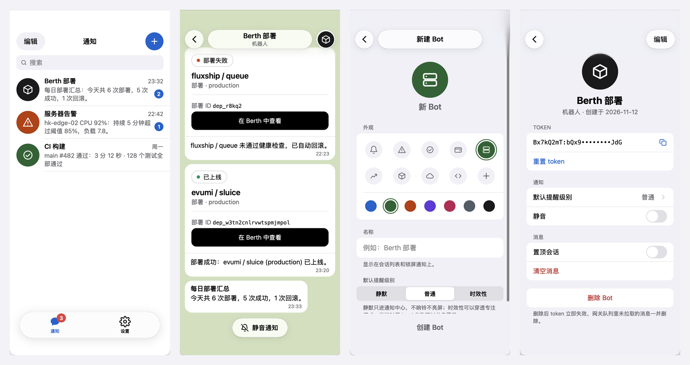

# Honk

[English](README.md)



Honk 是一个以 bot 为渠道的推送通知服务：每个 bot 都是一个独立的通知渠道，消息可以附带一张小型 HTML 卡片，格式参照 Telegram Bot API 10.4 的 HTML widget。iOS 通过 APNs 推送，Android 通过 FCM 推送（只支持带 GMS 的设备）。

## 仓库结构

| 目录 | 内容 | 状态 |
| --- | --- | --- |
| `gateway/` | Go + SQLite 网关：bot API、App API、短期消息队列、APNs/FCM 推送 | 第一版 |
| `app/` | nsh App（TSX）：会话列表、消息流、卡片渲染 | 第一版 |
| `ios/` | Swift 宿主、Notification Service Extension、共享包 HonkKit | 第一版；CI 的 `iosapp` job 构建模拟器版，尚未在真机上验证 |
| `android/` | Kotlin 宿主（嵌入 nsh App）、FirebaseMessagingService、共享模块 `:core`（网关客户端、本地库、同步） | 第一版；`:core` 在 JVM 上测试，CI 的 `android` job 构建 App，尚未在真机上验证 |

开发设计文档见 [docs/DESIGN.zh-CN.md](docs/DESIGN.zh-CN.md)，界面稿和截图见 [docs/design](docs/design/)。

## 工作方式

1. App 启动时把 APNs/FCM 的 push token 注册到网关，拿到 `device_secret`。
2. App 创建 bot，拿到 bot token，格式是 `<bot id>:<secret>`，形如 `aZ3kQ9xT:Gw2K7mx…`。bot id 是 8 位随机 base62 字符（以字母开头），不是自增序号。
3. 发送方调用 `/bot<token>/sendMessage`。网关把消息写进队列，然后推送一条只带横幅文字和 `msg_id` 的通知。
4. 设备端（iOS 的 NSE 或 Android 的 FCM Service）按 `msg_id` 调 `GET /v1/messages/:id` 拉完整消息（包括卡片），存进本地库。
5. App 打开时调 `GET /v1/sync` 补齐离线期间漏掉的消息，存好后调 `POST /v1/ack`。

队列里的消息默认保存 7 天；已 ack 的消息保留 1 天后删除。

推送失败而且可能恢复时（网络错误、超时、5xx、带 `retry_after` 的 429），网关从内存里的有界队列重试：2 秒、10 秒、60 秒后各一次，一共发 4 次；设备在这期间已 ack 这条消息、或者 push token 换了，就放弃。重试状态不跨重启保存，设备仍能从 `/v1/sync` 拿到消息。App 还会在后台大约每 6 小时同步一次（iOS 用 `BGAppRefreshTask`，Android 用 WorkManager）：应用修改和删除、更新角标，但不会补发通知。

## 运行网关

```bash
cd gateway
make run        # 不配推送凭据也能跑：推送会记日志后跳过
make test
```

Docker：

```bash
docker build -t honk gateway
docker run -p 8080:8080 -v honk-data:/data \
  -v /path/AuthKey_XXXX.p8:/secrets/apns.p8:ro \
  -v /path/service-account.json:/secrets/fcm.json:ro \
  -e HONK_APNS_KEY_FILE=/secrets/apns.p8 -e HONK_APNS_KEY_ID=XXXX \
  -e HONK_APNS_TEAM_ID=YYYY -e HONK_APNS_TOPIC=com.example.honk \
  -e HONK_FCM_CREDENTIALS_FILE=/secrets/fcm.json honk
```

### 环境变量

| 变量 | 默认值 | 说明 |
| --- | --- | --- |
| `HONK_ADDR` | `:8080` | 监听地址 |
| `HONK_DB` | `./data/honk.db` | SQLite 文件路径 |
| `HONK_MESSAGE_TTL` | `168h` | 消息在队列里保存多久 |
| `HONK_ACKED_KEEP` | `24h` | 已 ack 的消息再保留多久 |
| `HONK_SEND_RATE` / `HONK_SEND_BURST` | `5` / `20` | 每个 bot 每秒最多发几条 / 突发上限 |
| `HONK_REGISTER_PER_HOUR` | `10` | 每个 IP 每小时最多注册几台设备（突发 5） |
| `HONK_MAX_BOTS_PER_DEVICE` | `100` | 每台设备最多几个 bot |
| `HONK_APNS_KEY_FILE` | | APNs `.p8` key 文件路径；不设就不推 iOS |
| `HONK_APNS_KEY_ID` / `HONK_APNS_TEAM_ID` / `HONK_APNS_TOPIC` | | 设置了 key 文件时必填；topic 就是 bundle ID |
| `HONK_APNS_SANDBOX` | `false` | 用 APNs 开发环境，开发版构建要设为 true |
| `HONK_FCM_CREDENTIALS_FILE` | | Firebase service account JSON；不设就不推 Android |
| `HONK_PUSH_QUEUE` / `HONK_PUSH_WORKERS` | `1024` / `16` | 推送队列最多排几条（满了就丢弃并计数）/ 同时在发的推送数 |
| `HONK_REGISTER_KEY` | | 设了以后 `POST /v1/devices` 必须带相同的 `register_key`，`/v1/info` 会返回 `register_key_required`。App 的网关页有可选的「注册口令」输入框 |
| `HONK_METRICS_ADDR` | | 例如 `127.0.0.1:9100`：在单独的端口提供 Prometheus 文本格式的 `/metrics`；留空就不开 |
| `HONK_LOG_FORMAT` | `text` | 设成 `json` 输出结构化日志 |
| `HONK_LOG_LEVEL` | `info` | 设成 `debug` 会再记录每个请求（路径里的 bot token 不会出现在日志里） |

`/metrics` 有 `honk_messages_total{kind}`、`honk_pushes_total{platform,route,result}`（结果是 `ok`、`retry`、`token_gone`、`failed`）、`honk_push_retries_total`、`honk_push_dropped_total{reason}`、`honk_http_requests_total{class}`，以及量表 `honk_devices`、`honk_bots`、`honk_push_queue_length`。

## Bot API

地址是 `/bot<token>/<method>`，参数可以放在 GET 查询串、表单或 JSON 里。返回格式和 Telegram 一样：`{"ok":true,"result":…}` 或 `{"ok":false,"error_code":400,"description":"…"}`。

### sendMessage

| 参数 | 必填 | 说明 |
| --- | --- | --- |
| `body` | 是 | 正文，最多 4096 字符。横幅显示它，卡片下方也显示它；客户端不支持卡片时就只显示它 |
| `title` | | 标题，最多 256 字符 |
| `html` | | 卡片 HTML：原文最多 32 KB，zlib 压缩后最多 4 KB |
| `data` | | 卡片数据，最多 1 KB，通常是 JSON；用来填卡片里的 `{{key}}` 占位符 |
| `level` | | `passive`、`active` 或 `timeSensitive`；不填用 bot 的默认级别 |
| `group` | | 同一 bot 内的通知分组 |
| `id` | | 可替换 id：同一个 bot 再发相同 `id` 的消息，会替换掉之前那条 |
| `url` | | 消息的链接，http(s)：在会话里点这条消息时打开 |
| `copy` | | 长按菜单里「复制」用的文字 |
| `icon` | | 这条消息的头像，必须是 https；不填用 bot 头像 |

```bash
curl https://honk.example.com/bot$TOKEN/sendMessage \
  -d title="部署成功" -d body="sub2api / sluice 已上线" -d id=dep-42 \
  --data-urlencode 'html=<div><b>{{status}}</b></div>' -d 'data={"status":"已上线"}'
```

### editMessageData

修改卡片数据，不弹新通知。用 `message_id` 或 `id` 指定是哪条消息，`data` 是新数据。

### deleteMessage

删除消息，并撤回已经显示的系统通知。用 `message_id` 或 `id` 指定。

### getMe

返回这个 bot 的信息，可以用来测试 token 是否有效。

### 旧 token

短 bot id 之前的网关（数据库 schema v1）用自增整数做 bot id，token 形如 `4:Gw2K7mx…`。升级后每个 bot 都会分到一个短 id；旧 token 在重置之前照常可用，重置后的新 token 以短 id 开头。App 第一次同步时会用本机存的 token 调 `getMe` 查出对应的短 id（没有 token 就按创建时间和名称匹配），把这个 bot 的本地消息和设置迁移过去；连不上网关时保留这个 bot，下次再试。先更新 App 再升级网关：旧版 App 读不了短 id（`/v1/info` 的 `api` 是 2），新版 App 连旧网关也能用。

### 卡片 HTML

网关只保留白名单里的元素，其他元素连同子元素一起删掉：

- 文本和结构：`div`、`span`、`p`、`h1`–`h6`、列表、`table`、`details`、`pre`、`code`
- 交互：`button`、`a`
- 样式：`style`
- 图片：`img`（只接受 `data:` 图片）
- 内联 SVG
- 内联 `<script>`（profile 2，见下面「卡片脚本」）

以下内容会被删除：

- 带 `src` 或 `type` 不是 JavaScript 的脚本（包括 module）、`on*` 事件属性、表单控件
- 外部链接；`a` 只允许 `https://`、`#id` 或 `{{key}}`
- CSS 里引用外部资源的写法：`@import`、`expression()`、非 data: 的 `url()`
- SVG 属性值里不是 `url(#id)` 的 `url()`，以及带 CSS 转义（`\`）的值

渲染时客户端还会再按自己的 CSS 白名单过滤一遍。

App 把内联 SVG（`svg`、`g`、各种图形、`text`/`tspan`、渐变、`symbol`/`use`）画成图片：把清理过的子树重新写成 SVG 标记，只保留白名单里的元素和属性、卡片内的 `use` 引用（`#id`）和 `url(#id)` 填充，再栅格化。尺寸先看 CSS，再看 `width`、`height` 属性（`width="100%"` 占满卡片宽度，`height` 按 px），都没有时按 `viewBox` 的宽高比；`preserveAspectRatio`（包括 `none`）决定怎么填满这个框。`{{key}}`、`var()` 和 `currentColor` 在绘制前替换好；`<style>` 规则管不到 SVG 内部，所以 SVG 里的元素要用属性或固定颜色。`<title>` 或 `aria-label` 作为无障碍标签。旧版 App 会跳过内联 SVG。

### 卡片样式

除了 `style=""`，卡片也可以像 Telegram widget 那样写 `<style>`：

- 选择器：标签、`.class`、`#id`、属性选择器，组合写法（`div.card`），后代、子元素（`>`）和兄弟（`+`、`~`）组合符，`:first-child`、`:last-child`、`:nth-child()`，`:root`（`html`、`body` 也指它），一条规则可以写多个选择器
- 层叠：按优先级和先后顺序；内联 `style` 优先，除非规则写了 `!important`
- 变量：`:root` 或任意元素上的 `--x`，用 `var()` 读取；主题变量 `--tg-theme-*`
- 深色模式：`@media (prefers-color-scheme: dark)` 和 `light-dark()` 跟随 App 的外观
- `display: none` 隐藏元素；`<style>` 和 `class` 里也可以用 `{{key}}`

只生效前 400 条规则；其他媒体查询、`@keyframes`、伪元素和 `:hover` 会被忽略。

### 卡片脚本（profile 2）

卡片可以像 Telegram HTML widget 那样带内联脚本。iOS 和 Android App 给每张卡片开一个独立的 QuickJS 运行时（[quickjs-ng](https://github.com/quickjs-ng/quickjs)，代码在 `native/`），在后台线程上跑，不能联网、不能读写文件，内存 8 MB，每个任务 200 毫秒；超出就停止，卡片保留最后画出的样子。

- `window.TelegramWidget`：`chatData`（消息的 `data`）、`themeParams`、`colorScheme`；`onEvent('themeChanged' | 'activated' | 'deactivated', …)`；在点击处理函数里调用 `openLink(url)`、`copyText(text)`
- 精简 DOM：`getElementById`、`querySelector`、`textContent`、`innerHTML`、`classList`、`style`、`dataset`、`createElement`、`addEventListener('click', …)`
- 定时器，以及 4 KB 的 `localStorage`

脚本画出来的内容，App 同样按白名单过滤后再显示。消息允许查询（`allow_queries`）时，`request(data)`（1–64 字节，只能在点击处理函数里调，每次点击一次）把查询发给 bot，返回的 Promise 以 bot 的答案兑现；否则以 `WidgetRequestError` 拒绝（`NOT_ALLOWED`、`INVALID_DATA`、`TOO_MANY_REQUESTS`，15 秒无答案为 `TIMEOUT`）。旧版 App 和桌面演示（没有宿主）显示填好 `{{key}}` 的静态卡片，所以关键信息要写在 HTML 里。例子：

```html
<p id="n">{{count}}</p><button id="b">+1</button>
<script>
  let n = Number(JSON.parse(TelegramWidget.chatData).count);
  document.getElementById("b").addEventListener("click", () => {
    document.getElementById("n").textContent = String(++n);
  });
</script>
```

## App API

除了注册设备，其他接口都需要带 `Authorization: Bearer <device_secret>`。

| 接口 | 说明 |
| --- | --- |
| `GET /v1/info` | `{"name":"honk","version","api":2}`；设了 `HONK_REGISTER_KEY` 时多一个 `register_key_required` |
| `POST /v1/devices` | `{"platform":"ios"\|"android","push_token":"…","register_key":"…"}`（网关要求口令时才需要带 `register_key`），返回 `device` 和 `device_secret` |
| `GET` / `PUT` / `DELETE /v1/devices/me` | 读取设备信息；更新 push token；删除设备及它的所有 bot 和消息（App「设置 → 删除这台设备的数据」调用它，成功后再清空本机） |
| `GET` / `POST /v1/bots` | 列出 bot；创建 bot：`{"name","avatar","default_level"}`，返回 `bot` 和 `token`。`avatar` 是 `preset:<icon>:<#rrggbb>`、https URL，或 `local:<文件名>`：用户在 App 里从相册选的图片，只存在手机上（网关只存这个名字） |
| `GET` / `PATCH` / `DELETE /v1/bots/:id` | 读取、修改、删除一个 bot（`:id` 是 bot 的短 id） |
| `POST /v1/bots/:id/token` | 重置 token，旧 token 立即失效 |
| `GET /v1/messages/:id` | 拉一条消息；条目可能是 `message`、`edit` 或 `delete` |
| `GET /v1/sync?cursor=&limit=` | 拉 cursor 之后的消息，返回 `messages`、`cursor`、`has_more` |
| `POST /v1/ack` | `{"up_to": <id>}`：告诉网关这个 id 及之前的消息都已存好 |

`edit` 和 `delete` 条目用 `target_id` 或 `id` 指向原消息。原消息可能已经从队列删掉了，客户端要对自己本地存的那份执行。
