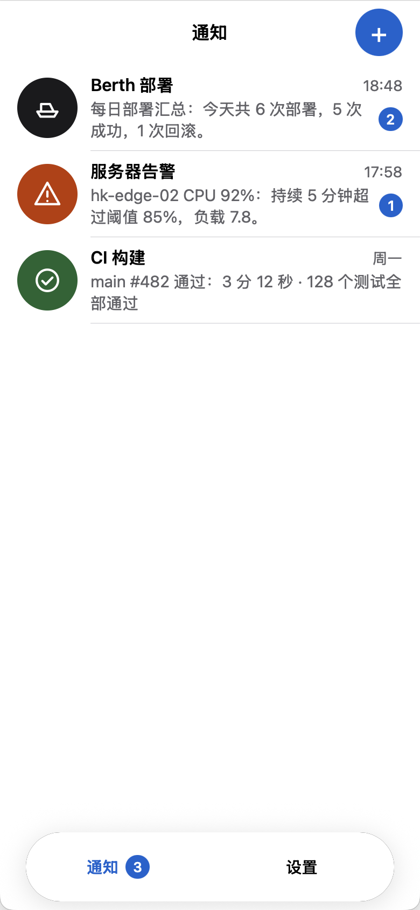
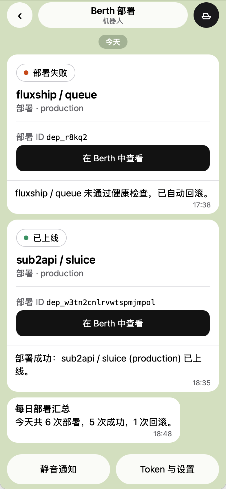
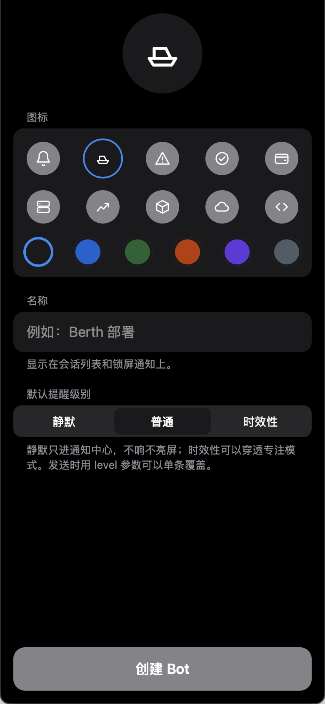
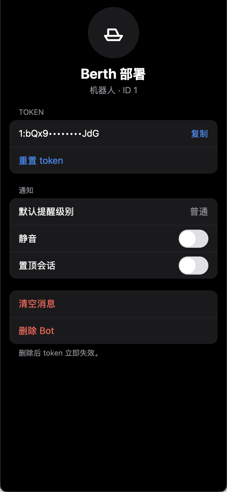

# 界面设计稿

这里是 Honk iOS 界面的设计稿源文件，可以在 claude.ai 的 Design 画布里打开编辑：[通知 Bot App 界面](https://claude.ai/artifact/Fgidi7KtB5JSJ1twf7BYMg)（私有，需要分享后别人才能打开）。

| 文件 | 画面 |
| --- | --- |
| `Main.dc.html` | 会话列表 |
| `Chat.dc.html` | 会话详情：部署卡片 |
| `NewBot.dc.html` | 新建 Bot |
| `BotCreated.dc.html` | 创建成功：token 和 curl 示例 |
| `BotSettings.dc.html` | Bot 设置 |
| `LockScreen.dc.html` | 锁屏通知：bot 头像横幅 |
| `canvas.json` | 画布布局 |

`.dc.html` 依赖 Design 画布的运行时，不能直接在浏览器里打开。

实际 App 的截图在 [../screenshots](../screenshots/)，由 `nsh test --target macos` 用演示数据截取，390×844：

| 会话列表 | 会话详情 |
| --- | --- |
|  |  |

| 新建 Bot（深色） | Bot 设置（深色） |
| --- | --- |
|  |  |
